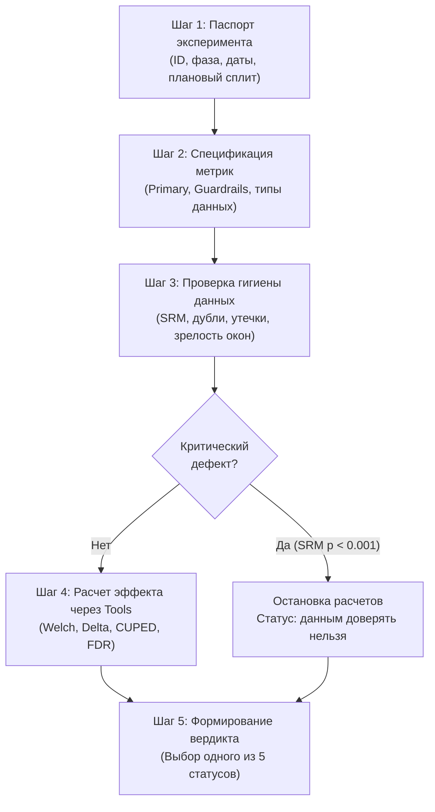

# Спецификация системы: ExpAgent (Experiment Audit & Quality Engine)

## 1. Назначение системы

**ExpAgent** — специализированная система ретроспективного аудита A/B-экспериментов. Система подключается к аналитическим хранилищам данных (ClickHouse, DuckDB, PostgreSQL), выполняет верификацию методологической корректности завершенных и текущих тестов, рассчитывает статистические эффекты через детерминированные инструменты и формирует структурированное заключение о надежности полученных результатов.

### Ключевые цели

* **Детекция ложноположительных результатов:** выявление тестов, ошибочно признанных успешными из-за подглядывания (peeking), пренебрежения ковариацией в ratio-метриках, отсутствия поправок на множественное тестирование или незамеченного дисбаланса трафика (SRM).
* **Устранение галлюцинаций LLM при расчетах:** вынос всей вычислительной и статистической логики в строго детерминированные функции (Tools) с валидацией входных и выходных параметров.
* **Пересчет совокупного эффекта программы экспериментов:** устранение расхождения между суммой заявленных продуктовыми командами локальных побед и фактической динамикой ключевых верхнеуровневых бизнес-метрик компании.

---

## 2. Проблематика и предпосылки разработки

В зрелых продуктовых компаниях с высокой культурой экспериментирования накапливаются сотни завершенных A/B-тестов. Традиционные платформы управления экспериментами оптимизированы под мониторинг текущих тестов и базовый расчет доверительных интервалов, но не обеспечивают ретроспективного аудита методологической гигиены.

Типичные источники смещения и ложных выводов:

1. **Нарушение фиксированного горизонта наблюдения (Peeking):** непрерывный мониторинг p-value с остановкой теста в момент пересечения порога $\alpha = 0.05$ без процедур последовательного анализа (sequential testing). Приводит к росту вероятности ошибки первого рода (FPR) до 20–40%.
2. **Игнорирование стохастической природы знаменателя в ratio-метриках:** расчет среднего чека (выручка / число заказов) или CTR через стандартный критерий Стьюдента/Уэлча без учета ковариации числителя и знаменателя приводит к искусственному занижению стандартной ошибки и ложной статистической значимости.
3. **Множественные проверки гипотез без контроля FWER/FDR:** одновременное тестирование десятков второстепенных метрик или множественных сегментов без процедур Бенджамини-Хохберга или Бонферрони.
4. **Пропуск Sample Ratio Mismatch (SRM):** появление скрытого смещения в сплитах ($p < 0.001$), свидетельствующее о нарушении рандомизации, селективном отвале пользователей или багах трекинга.
5. **Недостаточная мощность (Underpowered tests):** интерпретация отсутствия значимости как доказательства отсутствия эффекта при фактической мощности ниже 50% относительно ожидаемого MDE.
6. **Нарушение предпосылок методов снижения дисперсии (CUPED):** использование ковариат, скоррелированных с целевым воздействием, включение пересекающихся периодов или применение метода при околонулевой корреляции предпериода.

---

## 3. Архитектура и фундаментальные инварианты

Система построена на базе шаблона **ReAct (Reasoning + Acting)** с изоляцией контекста расчетов.

```
                      ┌──────────────────────────────────────┐
                      │             User / UI                │
                      │         (Streamlit Client)           │
                      └──────────────────┬───────────────────┘
                                         │ Task / Query
                                         ▼
                      ┌──────────────────────────────────────┐
                      │          LLM Orchestrator            │
                      │       (Harness / ReAct Loop)         │
                      │  - Prompt-инварианты (SOP)           │
                      │  - Валидация типов параметров        │
                      └──────────────┬───────────────┬───────┘
                                     │               │
                     SQL Tool Call   │               │ Stats Tool Call
                                     ▼               ▼
      ┌────────────────────────────────┐   ┌────────────────────────────────┐
      │       Data Access Layer        │   │    Deterministic Toolset       │
      │   (ClickHouse / DuckDB / PG)   │   │  (NumPy / SciPy / Statsmodels) │
      │  - Извлечение user-level данных│   │  - SRM (Chi-Square)            │
      │  - Изоляция raw SQL            │   │  - Welch t-test / Z-test       │
      │  - Логирование запросов        │   │  - Delta Method                │
      │                                │   │  - CUPED & Assumptions        │
      │                                │   │  - mSPRT / Always-Valid        │
      │                                │   │  - Multiple Testing (BH / Bonf)│
      └────────────────────────────────┘   └────────────────────────────────┘
```

### Архитектурные инварианты:

1. **Zero Mental Arithmetic:** LLM запрещено выполнять математические операции в тексте ответа. Любое числовое значение (p-value, доверительный интервал, точечная оценка, статистическая мощность, агрегированные суммы) поступает строго из возвращаемого значения зарегистрированного инструмента.
2. **User-Level Granularity:** статистические критерии, требующие оценки дисперсии, ковариаций или формы распределения (Welch, Delta Method, Bootstrap, CUPED), оперируют исключительно данными на уровне единицы рандомизации (user_id), а не предрассчитанными средними.
3. **Data/Instruction Separation:** данные из таблиц базы (названия экспериментов, описания гипотез, комментарии) валидируются как неструктурированные текстовые литералы и не могут изменять логику системного промпта и пайплайна проверок.
4. **Short-Circuit on Critical Defects:** при обнаружении критических дефектов данных (SRM с $p < 0.001$, перекрестные назначения пользователей в группы, потеря связности транзакций) агент принудительно прерывает выполнение ресурсоемких расчетов, выставляет статус «данным доверять нельзя» и блокирует объявление победителя.
5. **Auditable SQL Execution:** каждый SQL-запрос, сгенерированный агентом, логируется в аудит-трейс с фиксацией времени выполнения и структуры возвращенных данных.

---

## 4. Контур методологического аудита

Аудит каждого эксперимента выполняется в соответствии с матрицей верификации:

| № | Проверка                                          | Метод контроля                                                                                     | Пороговое условие / Критерий                                                                                                                 | Действие при нарушении                                                                                                        |
| :- | :-------------------------------------------------------- | :-------------------------------------------------------------------------------------------------------------- | :------------------------------------------------------------------------------------------------------------------------------------------------------------------- | :------------------------------------------------------------------------------------------------------------------------------------------------ |
| 1  | **SRM (Sample Ratio Mismatch)**                     | $\chi^2$-критерий согласия Пирсона                                                     | $p < 0.001$ при ожидаемом сплите                                                                                                                 | Блокировка признания эффекта; статус: `данным доверять нельзя`                              |
| 2  | **Изоляция групп**                     | Проверка пересечения множеств `user_id`                                            | $N_{\text{cross}} > 0$                                                                                                                                             | Фиксация доли утечки; при $N_{\text{cross}} / N > 0.1\%$ — статус `данным доверять нельзя`    |
| 3  | **Зрелость когорт (Window Maturity)** | Сравнение даты первой экспозиции и окна атрибуции                    | Экспозиция + Окно $\le$ Дата среза                                                                                                          | Исключение незрелых когорт либо присвоение статуса `промежуточный результат` |
| 4  | **Полнота выборки (CR / RPV)**        | Контроль знаменателя агрегатов                                                      | Знаменатель включает пользователей с нулевым числом целевых действий                                    | Принудительное заполнение нулями вместо `NULL`                                                              |
| 5  | **Ratio-метрики (AOV, RPV, CTR)**            | Дельта-метод для дисперсии отношения двух случайных величин | $\text{Var}(R) = \frac{1}{\bar{X}^2}[\text{Var}(Y) - 2R\text{Cov}(X,Y) + R^2\text{Var}(X)]$                                                                        | Пересчет стандартной ошибки и p-value; проверка расхождения с наивным t-тестом         |
| 6  | **Множественные гипотезы**     | Процедура Бенджамини-Хохберга (FDR) / Бонферрони                           | Контроль FDR на уровне $q = 0.05$ для secondary; Бонферрони для guardrails                                                         | Скорректированные p-value; отметка гипотез, потерявших значимость                              |
| 7  | **Риск подглядывания (Peeking)**   | Анализ длительности теста vs плановый $N$; mSPRT                               | Фактический $N < N_{\text{plan}}$ при отсутствии sequential-дизайна                                                                 | Флаг `PEEKING_RISK`; расчет always-valid p-value через mSPRT                                                                     |
| 8  | **Корректность CUPED**                  | Проверка предпосылок ковариаты                                                      | 1. $\vert\rho(X, Y)\vert \ge 0.3$2. Баланс $X$ между группами ($p > 0.05$)3. Предпериод строго до старта теста | При нарушении предпосылок откат к сырым оценкам (Unadjusted Welch)                                       |
| 9  | **Устойчивость к выбросам**    | Сравнение сырых оценок, винзоризации (99.5%) и бутстрапа              | Расхождение средних и медиан, влияние верхнего 0.1% квантиля                                                         | Предупреждение о доминировании выбросов («эффект китов»)                                         |
| 10 | **Мощность (Pre-Experiment Power)**         | Расчет необходимого объема выборки по baseline и MDE                          | $\text{Power} = 1 - \beta \ge 0.8$ при заданном $\alpha = 0.05$                                                                                       | При $N_{\text{fact}} \ll N_{\text{req}}$ — статус `данных недостаточно`                                           |

---

## 5. Спецификация детерминированных инструментов (Tools Interface)

Каждый инструмент представляет собой чистую функцию на Python без состояния (stateless).

### 5.1. Модуль целостности данных (`tools/srm.py`, `tools/data_quality.py`)

#### `srm_check(n_control: int, n_treatment: int, expected_ratio: float = 0.5) -> dict`

* **Назначение:** выявление перекоса выборки.
* **Выходной контракт:**
  ```json
  {
    "test": "chi_square_goodness_of_fit",
    "chi2_statistic": 12.45,
    "p_value": 0.000418,
    "is_srm": true,
    "verdict": "SRM_BROKEN"
  }
  ```

#### `data_quality_check(assignments: pd.DataFrame, events: pd.DataFrame, conversion_window_days: int) -> dict`

* **Назначение:** аудит уникальности пользователей, перекрестных назначений и зрелости конверсионных окон.
* **Выходной контракт:**
  ```json
  {
    "total_users": 50000,
    "duplicate_users": 0,
    "cross_assigned_users": 12,
    "cross_assigned_ratio": 0.00024,
    "immature_users_ratio": 0.0,
    "has_critical_defects": false,
    "defects_summary": []
  }
  ```

---

### 5.2. Модуль параметрических и непараметрических тестов (`tools/frequentist_tests.py`, `tools/delta_method.py`)

#### `welch_ttest(control_values: np.ndarray, treatment_values: np.ndarray, alpha: float = 0.05) -> dict`

* **Назначение:** двухвыборочный t-критерий Уэлча для непрерывных метрик при гетероскедастичности.
* **Выходной контракт:** `statistic`, `p_value`, `ci_lower`, `ci_upper`, `mean_control`, `mean_treatment`, `relative_effect_pct`, `is_significant`.

#### `proportion_ztest(conversions_control: int, n_control: int, conversions_treatment: int, n_treatment: int, alpha: float = 0.05) -> dict`

* **Назначение:** двусторонний Z-критерий разности долей для бинарных метрик (конверсий).

#### `fisher_exact(conversions_control: int, n_control: int, conversions_treatment: int, n_treatment: int) -> dict`

* **Назначение:** точный тест Фишера при малом числе событий ($\min(\text{conversions}) < 30$).

#### `delta_method_ratio_test(num_control: np.ndarray, denom_control: np.ndarray, num_treatment: np.ndarray, denom_treatment: np.ndarray, alpha: float = 0.05) -> dict`

* **Назначение:** линеаризация и расчет состоятельной оценки дисперсии отношений случайных величин (выручка на заказ, клики на показ).
* **Выходной контракт:**
  ```json
  {
    "ratio_control": 1240.50,
    "ratio_treatment": 1298.10,
    "absolute_difference": 57.60,
    "relative_effect_pct": 4.64,
    "se_delta": 28.12,
    "se_naive": 14.05,
    "p_value_delta": 0.0406,
    "p_value_naive": 0.000041,
    "ci_lower": 2.48,
    "ci_upper": 112.72,
    "naive_would_be_significant": true,
    "is_significant": true
  }
  ```

---

### 5.3. Модуль снижения дисперсии и устойчивости (`tools/cuped.py`, `tools/bootstrap.py`, `tools/winsorization.py`)

#### `cuped_transform(metric_values: np.ndarray, covariate_values: np.ndarray, groups: np.ndarray) -> dict`

* **Назначение:** трансформация $Y_{\text{cuped}} = Y - \theta (X - \mathbb{E}[X])$ с предварительной проверкой предпосылок.
* **Выходной контракт:**
  ```json
  {
    "theta": 0.724,
    "correlation_xy": 0.68,
    "variance_reduction_pct": 46.24,
    "covariate_balance_p_value": 0.42,
    "covariate_balance_ok": true,
    "assumptions_met": true,
    "warnings": []
  }
  ```

#### `bootstrap_mean_diff(control: np.ndarray, treatment: np.ndarray, n_bootstrap: int = 5000, ci_level: float = 0.95, seed: int = 42) -> dict`

* **Назначение:** векторизованный процентильный бутстрап для оценки разности средних при сильной асимметрии данных.

#### `winsorize(values: np.ndarray, percentile: float = 99.5) -> np.ndarray`

* **Назначение:** ограничение тяжелых хвостов распределения по заданному квантилю.

---

### 5.4. Модуль последовательного анализа и множественных поправок (`tools/sequential.py`, `tools/multiple_testing.py`)

#### `msprt_test(control: np.ndarray, treatment: np.ndarray, tau_squared: float, alpha: float = 0.05) -> dict`

* **Назначение:** Mixture Sequential Probability Ratio Test, расчет мартингального always-valid p-value для защиты от подглядывания.

#### `benjamini_hochberg(p_values: list[float], alpha: float = 0.05) -> dict`

* **Назначение:** контроль доли ложных открытий (FDR) при одновременной проверке семейств гипотез.

#### `bonferroni(p_values: list[float], alpha: float = 0.05) -> dict`

* **Назначение:** консервативный контроль групповой вероятности ошибки (FWER) для guardrail-метрик.

---

### 5.5. Модуль бизнес-трансляции (`tools/revenue_calculator.py`)

#### `effect_to_annual_revenue(relative_effect: float, ci_lower: float, ci_upper: float, baseline_daily_revenue: float) -> dict`

* **Назначение:** детерминированный расчет годового инкремента в денежном выражении с доверительным интервалом.

---

## 6. Протокол работы агента (Standard Operating Procedure)

Аудит выполняется строго последовательно в 5 этапов.



### Иерархия присвоения статуса (проверка сверху вниз):

1. **«данным доверять нельзя»** — зафиксирован SRM ($p < 0.001$), утечка пользователей между группами или нарушение контура трекинга.
2. **«есть признаки ухудшения»** — статистически значимое падение ключевой primary-метрики либо пробитие порогов безопасности в guardrails.
3. **«промежуточный результат»** — когорты не завершили окно конверсии, либо тест остановлен раньше срока без применения процедур sequential testing.
4. **«данных недостаточно»** — фактический размер выборки не обеспечивает мощности $\ge 80\%$ для детекции планового MDE, либо первичная гипотеза не была зафиксирована до начала эксперимента.
5. **«есть основания для следующего шага»** — данные валидны, primary-метрика показала статистически подтвержденный рост без деградации guardrails (или при достаточной мощности подтверждено отсутствие эффекта MDE, что обосновывает закрытие гипотезы).

### Формат итогового отчета:

```json
{
  "status": "есть основания для следующего шага",
  "has_srm": false,
  "data_quality_passed": true,
  "primary_significant": true,
  "decision_recommendation": "rollout"
}
```

Отчет включает:

1. Канонический статус решения.
2. Резюме для менеджмента (2–4 предложения: эффект, риски, следующее действие).
3. Паспорт эксперимента (структурная таблица метаданных).
4. Таблица проверок качества данных (проверка, фактическое значение, статус).
5. Таблица эффектов (Primary и Guardrail метрики: baseline, точечная оценка, 95% CI, p-value, вердикт).
6. Аудит-трейс: журнал выполненных SQL-запросов и вызванных Tools с переданными аргументами.

---

## 7. Хранилище данных и уровень доступа (Data Access Layer)

Система поддерживает два режима работы с базами данных:

1. **DuckDB (`db/duckdb_local.py`):**
   * Встроенный аналитический движок для локального запуска, CI/CD и выполнения тестов Trap Suite.
   * Данные загружаются непосредственно в оперативную память (`:memory:`) или локальные файлы parquet/csv.
2. **ClickHouse (`db/clickhouse_client.py`):**
   * Производительный коннектор через `clickhouse-connect` для работы с боевыми хранилищами событий и экспозиций.
   * Поддержка чтения метаданных через системные таблицы `system.columns` для автоматической передачи схемы данных в системный промпт агента.

### Требования к генерации SQL:

* Зарезервированные слова СУБД экранируются двойными кавычками: `"group"`, `"order"`, `"user"`.
* Строковые константы оборачиваются в одинарные кавычки: `WHERE "variant" = 'treatment'`.
* Фильтрация событий выполняется строго по времени экспозиции: $t_{\text{event}} \ge t_{\text{exposed}}$ (защита от post-assignment bias).

---

## 8. Верификационный комплекс: Trap Suite (20 бенчмарков)

Для валидации надежности агента и исключения регрессий при модификации промптов или замене моделей разработан специализированный набор из 20 синтетических сценариев с детерминированным математическим основанием.

| ID | Сценарий                 | Заложенная методологическая ловушка                                                                     | Ожидаемый вердикт агента                                                          |
| :- | :------------------------------- | :--------------------------------------------------------------------------------------------------------------------------------------- | :------------------------------------------------------------------------------------------------------ |
| 01 | `clean_win`                    | Корректный эксперимент с реальным эффектом                                                         | `есть основания для следующего шага`                                    |
| 02 | `peeking_false_win`            | Остановка теста на раннем ложном всплеске ($N = 0.2 N_{\text{plan}}$)                              | `промежуточный результат` / `PEEKING_RISK`                                    |
| 03 | `srm_broken`                   | Перекос сплита 52/48 при дизайне 50/50 ($p < 10^{-4}$)                                                          | `данным доверять нельзя`                                                          |
| 04 | `ratio_without_delta`          | Ratio-метрика, значимая в t-тесте ($p=0.03$), но незначимая в Delta ($p=0.12$)                     | `данных недостаточно` / отсутствие значимости                   |
| 05 | `multiple_metrics_no_fdr`      | 10 secondary-метрик, 1 ложноположительная, исчезающая при BH                                        | `данных недостаточно` (по secondary)                                              |
| 06 | `underpowered_lucky`           | Выборка 10% от требуемой, случайно получен $p < 0.05$                                                 | `данных недостаточно`                                                               |
| 07 | `outlier_driven`               | Эффект сформирован 3 аномальными покупками («китами»)                                       | Предупреждение об устойчивости; винзоризация                    |
| 08 | `cuped_bad_covariate`          | Предпериод со слабой корреляцией ($\rho = 0.08$)                                                          | Предупреждение о невалидности CUPED                                          |
| 09 | `wrong_test_mwu_revenue`       | Разница распределений без изменения среднего чека                                            | Использование Welch t-test вместо MWU                                                |
| 10 | `clean_loss`                   | Корректный тест со статистически значимой деградацией                                    | `есть признаки ухудшения`                                                        |
| 11 | `novelty_effect`               | Эффект первой недели с полным затуханием на 2–3 неделях                                     | `промежуточный результат` / флаг нестационарности           |
| 12 | `segment_simpsons`             | Парадокс Симпсона при разнородных сегментах мобильного и десктоп трафика | Указание на гетерогенность сегментов                                   |
| 13 | `cross_assigned_users`         | 1.5% пользователей получили оба флага в ходе сессий                                              | `данным доверять нельзя`                                                          |
| 14 | `immature_cohorts`             | 30% пользователей не завершили 7-дневное окно конверсии                                      | `промежуточный результат`                                                       |
| 15 | `aa_test_false_positive`       | А/А-тест, показавший $p = 0.04$ из-за случайного шума                                                | Корректная фиксация отсутствия истинного эффекта            |
| 16 | `three_variants_no_correction` | A/B/C тест без поправки на множественные сравнения с контролем                          | Применение поправки Даннетта / Бонферрони                           |
| 17 | `sequential_valid_stop`        | Остановка по правилам mSPRT с пересечением границы $p_{\text{always-valid}} < \alpha$           | `есть основания для следующего шага`                                    |
| 18 | `extreme_skew_revenue`         | Сверхтяжелые хвосты распределения, требующие bootstrap                                           | Применение Bootstrap-оценки                                                             |
| 19 | `cuped_strong_valid`           | Валидный CUPED с $\rho = 0.72$ и балансом предпериода                                                     | `есть основания для следующего шага` (с ростом точности) |
| 20 | `mixed_issues`                 | Сочетание SRM и множественных метрик                                                                        | `данным доверять нельзя` (срабатывание приоритета SRM)      |

---

## 9. Структура репозитория

```text
exp_Agent/
├── db/                                # Слой взаимодействия с источниками данных
│   ├── clickhouse_client.py           # Коннектор к ClickHouse
│   ├── duckdb_local.py                # Встроенный аналитический движок DuckDB
│   └── synthetic_generator.py         # Генератор синтетических когорт и ловушек
│
├── harness/                           # Контур оркестрации и LLM-интеграции
│   ├── agent.py                       # ReAct-цикл и диспетчеризация Tool Calls
│   ├── system_prompt.py               # Системный промпт (SOP) и шаблонизатор
│   └── tool_registry.py               # Схемы OpenAI Function Calling и маппинг вызовов
│
├── tools/                             # Детерминированные статистические модули
│   ├── srm.py                         # Проверка Sample Ratio Mismatch
│   ├── data_quality.py                # Аудит целостности и перекрестных назначений
│   ├── power_analysis.py              # Pre-experiment расчет мощности и MDE
│   ├── frequentist_tests.py           # Welch t-test, Z-test, Fisher exact
│   ├── delta_method.py                # Дельта-метод для ratio-метрик
│   ├── cuped.py                       # CUPED и валидация предпосылок ковариат
│   ├── bootstrap.py                   # Векторизованный процентильный бутстрап
│   ├── sequential.py                  # mSPRT и always-valid p-values
│   ├── multiple_testing.py            # Поправки Бенджамини-Хохберга и Бонферрони
│   ├── winsorization.py               # Винзоризация выбросов
│   └── revenue_calculator.py          # Расчет финансового эффекта в деньгах
│
├── trap_suite/                        # Верификационный комплекс бенчмарков
│   ├── traps/                         # 20 сценариев экспериментов-ловушек
│   └── expected_verdicts.json         # Эталонные разметки для регрессионного анализа
│
├── ui/                                # Пользовательский интерфейс
│   └── app.py                         # Streamlit-интерфейс: чат, аудит-дашборд, SQL-лог
│
├── tests/                             # Автоматические тесты
│   ├── test_tools_math.py             # Юнит-тесты формул и критериев
│   ├── test_trap_suite.py             # Интеграционный прогон Trap Suite через агента
│   └── test_db_connectors.py          # Тестирование чтения/записи DuckDB и ClickHouse
│
├── requirements.txt                   # Зависимости окружения
└── README.md                          # Руководство по установке и локальному запуску
```

---

## 10. Границы применимости и Non-Goals

Для обеспечения качества архитектуры четко зафиксированы границы функциональности системы:

### Входит в периметр системы:

* Автоматизированный ретроспективный аудит завершенных экспериментов.
* Детекция методологических нарушений и смещений данных.
* Пересчет доверительных интервалов и p-value корректными статистическими методами.
* Формирование проверяемой трассировки расчетов с исходным SQL и вызовами инструментов.
* Полная изоляция вычислений внутри локального контура при использовании локальных LLM или защищенных API.

### Явные Non-Goals (не входит в объем системы):

* **Управление фиче-флагами и сплитованием:** система не осуществляет маршрутизацию трафика пользователей в реальном времени.
* **Семантический слой метрик:** система не заменяет dbt или корпоративные каталоги метрик; схемы таблиц маппятся декларативно.
* **Автоматическое безусловное принятие решений:** вердикт агента является аналитическим заключением для человека, принимающего решение, и не инициирует автоматическую раскатку изменений на продакшн.
* **Post-hoc Power Analysis:** система принципиально не рассчитывает ретроспективную мощность на основе наблюдаемого эффекта, предотвращая методологическую ошибку подмены понятий.
